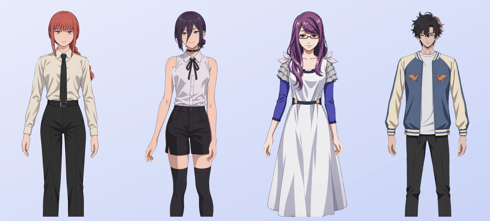
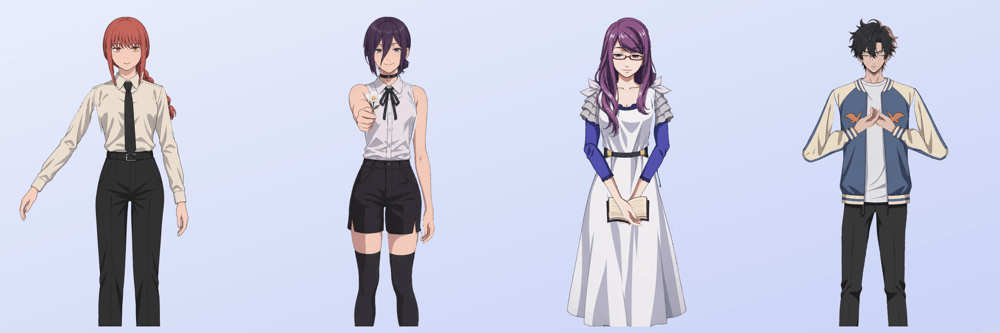
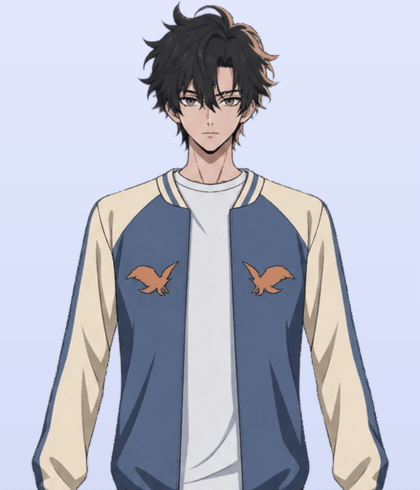
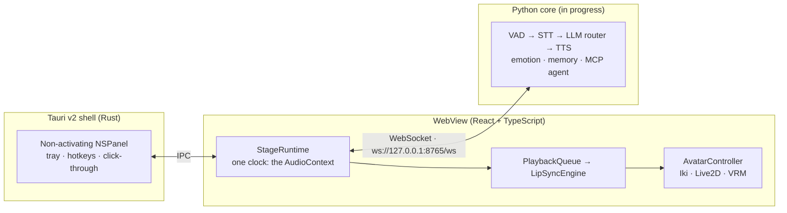

<div align="center">


# 光 Hikari

**A local-first anime AI companion that lives on your Mac's desktop.**

She floats over every app, talks with you in Hindi, English and Hinglish with phoneme-accurate lip sync, and moves like the character she is.

[](https://github.com/JayDev-27/Hikari/actions/workflows/checks.yml)
[](https://github.com/JayDev-27/Hikari/actions/workflows/rust.yml)


[](LICENSE)

[Quick start](#-quick-start) · [Characters](#-the-cast) · [Architecture](#-how-it-works) · [Roadmap](#-roadmap) · [Contributing](#-contributing)

<br>



</div>

> [!NOTE]
> **Early development.** The desktop body is far along: the stage, renderers, lip sync, mic and push-to-talk, Character Studio and the chat panel all work today. The voice brain (speech-to-text, LLM, text-to-speech), memory and Mac control are still being built (`core/`). Until then, a dev fake core and an in-browser mock turn drive her. See the [roadmap](#-roadmap).

## ✨ Highlights

- 🪟 **Lives on your desktop.** A transparent, non-activating panel that floats over every Space and full-screen app without stealing focus. Clicks pass through everywhere except where she's actually drawn.
- 💋 **Lips that match the audio.** Hindi and English phonemes map to visemes with coarticulation and full m/b/p closure, landing within **±8 ms** of what you hear, Bluetooth latency included.
- 🎭 **Characters that act like themselves.** Each character has a signature move: Makima's finger-gun, Rize's book and ghoul eyes, Cheng Xiaoshi's clap and photo dive. Natural hand gestures run alongside.
- 🎙️ **Push-to-talk or always listening.** A 16 kHz mic worklet with echo cancellation, device select, mute and barge-in: interrupt her mid-sentence.
- 🧑‍🎨 **Character Studio.** Switch characters, import your own Live2D, Iki or VRM pack (folder or zip) with its licence shown, or just type `switch to Reze` in chat.
- 🔒 **Local first.** Everything runs on your Mac by default; cloud providers are optional.

## 🎭 The cast

Four hand-rigged characters run on **Iki**, a lightweight 2D renderer built for Hikari. Each one has a persona, idle life (breathing, blinking, eyes that follow your cursor) and a signature move that plays on cue.



<table>
  <tr>
    <td width="50%" align="center">
      <br>
      <sub><b>Rize Kamishiro</b>: her eyes turn ghoul red mid-conversation.</sub>
    </td>
    <td width="50%" align="center">
      <br>
      <sub><b>Cheng Xiaoshi</b>: raises the photo and dives in.</sub>
    </td>
  </tr>
</table>

| Character | Renderer | Signature move |
|---|---|---|
| Makima | Iki | Finger-gun "bang" |
| Reze | Iki | Offers a flower |
| Rize Kamishiro | Iki | Reads her open book · ghoul eyes |
| Cheng Xiaoshi | Iki | Claps · photo dive |
| Lu Guang, Hiyori, Haru, Mao, Rice | Live2D (Cubism) | Expressions and motions from the model |

Build your own Iki character from one reference picture: [`docs/IKI.md`](docs/IKI.md).

## 🚀 Quick start

**Requirements:** macOS 13+ on Apple Silicon, Node 24, pnpm 12 and Rust (via [rustup](https://rustup.rs)).

```bash
git clone https://github.com/JayDev-27/Hikari.git
cd Hikari
pnpm install
pnpm dev
```

The four Iki characters work out of the box. Double-click her, or press and release <kbd>⌥ Space</kbd> with no core running, to play a demo conversation with lip sync.

<details>
<summary><b>Optional: Live2D models</b></summary>

Live2D's Cubism Core is licensed, so it's never in this repo. Download **Cubism SDK for Web** from [live2d.com](https://www.live2d.com/en/sdk/download/web/) (this means accepting Live2D's licence), then:

```bash
pnpm -F desktop fetch:assets --sdk ~/Downloads/CubismSdkForWeb-5-r.5.zip
```

</details>

<details>
<summary><b>Talk to her without the real core</b></summary>

```bash
pnpm -F desktop fake-core                       # echoes your voice back
pnpm -F desktop console --say "Hello Hikari"    # she speaks via macOS say
```

Use `VITE_MIC_MODE=open pnpm dev` for always-listening instead of push-to-talk.

</details>

### Hotkeys

| Keys | Action |
|---|---|
| <kbd>⌥ Space</kbd> | Push to talk (release ends your turn) |
| <kbd>⌘ ⇧ M</kbd> | Mute |
| <kbd>⌘ ⇧ Esc</kbd> | Panic stop |

### Commands

| Command | What it does |
|---|---|
| `pnpm dev` | Run the app in dev mode |
| `pnpm build` | Bundle `Hikari.app` and a `.dmg` |
| `pnpm -F desktop test` | Unit tests: gestures, lip sync, character packs, protocol, runtime |
| `pnpm -F desktop avsync` | Audible A/V sync regression (~6 s, exit 0 = within ±40 ms) |
| `pnpm -F desktop audit:models` | Audit Live2D rigs against Cubism standards |
| `pnpm -F desktop console` | Drive the core over the wire protocol, no app needed |
| `pnpm gen:protocol` | Regenerate protocol types from the schema |

## 🧠 How it works



One JSON Schema in [`packages/protocol`](packages/protocol) generates the TypeScript types for the app and the Pydantic models for the core, with a versioned handshake.

More detail: [`docs/ARCHITECTURE.md`](docs/ARCHITECTURE.md) · research with sources: [`docs/RESEARCH.md`](docs/RESEARCH.md) · decision log: [`DECISIONS.md`](DECISIONS.md)

<details>
<summary><b>Project layout</b></summary>

```
apps/desktop/        Tauri + React app: stage, avatars, lip sync, audio, Studio, chat, dev tools
packages/protocol/   Shared wire protocol: JSON Schema → generated types
characters/          Character packs: character.json, persona.md, Iki models (Live2D fetched separately)
docs/                Architecture, research, plan, Iki pipeline, licences
core/                Python core: voice pipeline, memory, agent (in progress)
```

</details>

## 🗺️ Roadmap

- [x] **M0** Desktop stage, Live2D renderer, lip sync, A/V sync, protocol and console
- [ ] **M1** Voice loop: mic, push-to-talk and barge-in are done on the desktop side; VAD → STT → LLM → TTS streaming under 1.2 s comes with the core
- [ ] **M2** Personas: Character Studio, pack import, persona switcher and chat are done; Hindi / English / Hinglish handling comes with the core
- [ ] **M3** Emotions, layered gestures, VRM renderer
- [ ] **M4** Multi-provider router with failover, hardware profiles for 8 GB Macs
- [ ] **M5** Long-term memory and a memory browser
- [ ] **M6** Voice Lab: consented voice cloning
- [ ] **M7** Mac-control agent (MCP) with safety tiers and an audit log
- [ ] **M8** Onboarding, performance, signed `.dmg`

The full plan is in [`docs/PLAN.md`](docs/PLAN.md).

## 🤝 Contributing

Bug fixes, docs and tests are welcome. For a larger change, [open an issue](https://github.com/JayDev-27/Hikari/issues/new) first to agree on scope. Fork, branch, and open a pull request against `main` explaining what changed and how you checked it; add a short screen recording for anything visible on the desktop. If you change the wire schema, run `pnpm gen:protocol` and commit the regenerated types.

Run the same checks CI runs:

```bash
pnpm install --frozen-lockfile
pnpm check:protocol
pnpm -F desktop lint --max-warnings 0
pnpm typecheck
pnpm -F desktop test
pnpm -F desktop build
cargo fmt --check --manifest-path apps/desktop/src-tauri/Cargo.toml
cargo clippy --locked --all-targets --manifest-path apps/desktop/src-tauri/Cargo.toml -- -D warnings
```

GitHub Actions runs two workflows. **Code checks** runs on Ubuntu for every push and pull request: lint, types, tests, the Live2D rig audit, the frontend build, plus parse checks for pipeline scripts, JSON validity for character packs, and a guard against committing Cubism Core or secrets. **Rust checks** runs on macOS only when the Tauri shell changes: `cargo fmt`, Clippy and tests. Dependabot proposes dependency updates weekly.

### Contributors

Thanks to everyone who has helped build Hikari. This picture updates itself: your avatar appears here after your first contribution is merged.

<a href="https://github.com/JayDev-27/Hikari/graphs/contributors">
  
</a>

## 📜 Assets & licences

Hikari's own code is under the [MIT License](LICENSE). Third-party models, runtimes and SDKs keep their own licences; [`docs/LICENSES.md`](docs/LICENSES.md) lists each one.

- **Live2D Cubism Core** is proprietary (Live2D PSLA). It's fetched from the official SDK, bundled only inside the built app, and never committed here.
- **Sample models** (Hiyori, Haru, Mao, Rice) are under the Live2D Free Material License. *This content uses sample data owned and copyrighted by Live2D Inc.*
- **Makima, Reze, Rize Kamishiro, Cheng Xiaoshi and Lu Guang** are fan rigs with original personas. The character designs belong to their rights holders, and no franchise voice recordings are included.
- **Voice cloning** requires a recorded consent file for any voice other than your own.

<div align="center">
<br>
<sub>Made with 光 for the desktop. If Hikari made you smile, a ⭐ helps others find her.</sub>
<br>
<a href="#光-hikari">Back to top ↑</a>
</div>
